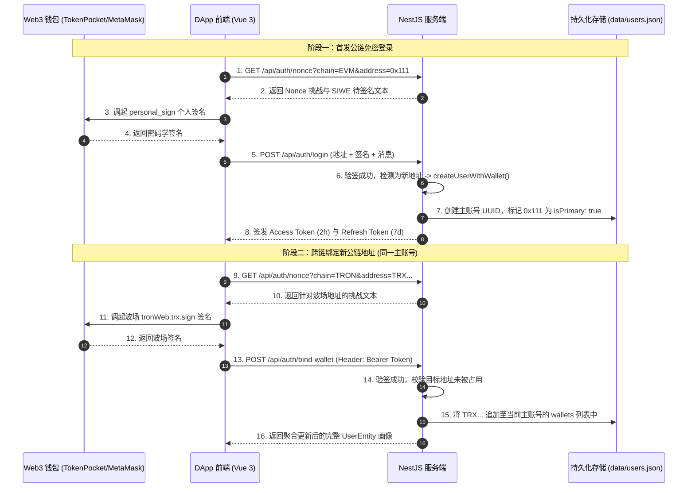

# 多链统一账户体系与数据库迁移追踪指南
# (Multi-Chain Unified Identity & Database Migration Technical Guide)

> 本文档系统记录了本项目 **“单主账号 · 多公链地址聚合 (1 Master Account · N Chain Addresses)”** 的完整架构设计、鉴权流程、数据库持久化机制、日常运维命令与生产数据库迁移演进方案，方便团队长期技术追溯与维护。

---

## 目录
- [一、 多链统一身份设计哲学](#一-多链统一身份设计哲学)
- [二、 账号核心生命周期与鉴权流程](#二-账号核心生命周期与鉴权流程)
  - [1. 首次免密注册登录](#1-首次免密注册登录)
  - [2. 跨链钱包所有权绑定 (关键逻辑)](#2-跨链钱包所有权绑定-关键逻辑)
  - [3. 跨链钱包反向免密登录](#3-跨链钱包反向免密登录)
  - [4. 安全解绑机制](#4-安全解绑机制)
- [三、 数据库模型与持久化存储](#三-数据库模型与持久化存储)
  - [1. 当前存储结构 (data/users.json)](#1-当前存储结构-datausersjson)
  - [2. 内存双重反查索引架构](#2-内存双重反查索引架构)
- [四、 数据库日常运维与管理命令手册](#四-数据库日常运维与管理命令手册)
- [五、 生产级关系型数据库迁移规范 (PostgreSQL / MySQL)](#五-生产级关系型数据库迁移规范-postgresql--mysql)
  - [1. 生产数据库表结构 (ER 关系设计)](#1-生产数据库表结构-er-关系设计)
  - [2. 存量数据无损迁移脚本 (Seed / Migration Script)](#2-存量数据无损迁移脚本-seed--migration-script)
  - [3. ORM 迁移命令速查表 (Prisma / TypeORM)](#3-orm-迁移命令速查表-prisma--typeorm)
- [六、 DApp 与管理后台双前端工程架构](#六-dapp-与管理后台双前端工程架构)
  - [1. 独立 DApp (multichain-dapp)](#1-独立-dapp-multichain-dapp)
  - [2. 集成管理后台 (admin)](#2-集成管理后台-admin)
  - [3. 核心踩坑与兼容方案 (Express 5 & TokenPocket)](#3-核心踩坑与兼容方案-express-5--tokenpocket)

---

## 一、 多链统一身份设计哲学

在传统单链 DApp 中，一个钱包地址往往直接代表一个用户；但在跨链生态（同时支持 EVM、Solana、TRON）中，用户的同一个助记词或物理钱包在不同链上会派生出不同格式的地址：
- **EVM 系列**：以太坊 / BSC / Arbitrum / Base (`0x...` 42位十六进制)
- **Solana 生态**：Ed25519 (`J4Ff...` Base58 编码)
- **TRON 波场**：Base58Check (`TRXb...` 或 `41...` 格式)

### 核心设计原则：单账号 · 多链聚合
1. **全局唯一用户主体**：一个用户在系统中**全局只有且仅有 1 个主账号 (`id: uuid`)**，不可因为用户切换到不同的链而产生多个孤立账号。
2. **多链地址矩阵聚合**：主账号名下挂载 `wallets` 数组，聚合其名下的全部链地址。
3. **资产与权限互通**：用户不论通过名下哪一条链的钱包登录，均享受相同的身份画像、资产余额与管理权限。
4. **互斥防重**：任意公链地址在全网具备唯一性，严禁被两个不同的主账号同时绑定。

---

## 二、 账号核心生命周期与鉴权流程



### 1. 首次免密注册登录
- **接口**：`POST /api/auth/login`
- **逻辑**：
  1. 校验 Nonce 挑战未过期且单次有效（防重放）；
  2. 密码学校验钱包对该消息的数字签名；
  3. 通过 `(chain, address)` 检索索引，若不存在则调用 `createUserWithWallet`；
  4. 生成主账号 UUID，首发链标记为 `primaryWallet`，`isPrimary: true`；
  5. 签发双 JWT 令牌返回。

### 2. 跨链钱包所有权绑定 (关键逻辑)
- **接口**：`POST /api/auth/bind-wallet`（必须携带已登录主账号的 Bearer JWT）
- **核心防错设计**：
  - **身份守卫**：必须已成功登录主账号；
  - **所有权证明**：新钱包必须对服务端的随机 Nonce 完成密码学签名，证明当前用户持有该新钱包私钥；
  - **唯一性排他锁**：如果该新地址已绑定在其他主账号名下，直接抛出 `409 Conflict` 冲突拒绝；如果已在当前账号名下，抛出 `400 BadRequest`；
  - **原子追加**：将新地址加入当前主账号的 `wallets` 数组中，并保存入库。

### 3. 跨链钱包反向免密登录
用户绑定多链后，未来无论使用哪一条链的钱包在任意设备登录：
```typescript
// auth.service.ts
let user = await this.userService.findUserByWallet(dto.chain, dto.address);
if (user) {
  // 命中已绑定的主账号，直接签发登录，绝不新建账号！
  return this.generateTokens(user, dto.address, dto.chain);
}
```

### 4. 安全解绑机制
- **接口**：`POST /api/auth/unbind-wallet`
- **保护策略**：
  - **主钱包保护**：标记为 `isPrimary: true` 的初始主钱包禁止直接解绑；
  - **孤岛保护**：若账号下仅剩 1 个钱包，禁止解绑（防止用户主账号变成无法登录的死账号）。

---

## 三、 数据库模型与持久化存储

### 1. 当前存储结构 (`data/users.json`)
开发与测试阶段采用了无外部依赖的原子 JSON 本地磁盘持久化，每个账号的结构示例如下：

```json
[
  {
    "id": "3e795879-7b6e-4811-8d9f-ae3bc3b85dfb",
    "primaryWallet": {
      "chain": "EVM",
      "address": "0x36b8a47da48830b42a04156ec6990b015ffbfa39"
    },
    "wallets": [
      {
        "chain": "EVM",
        "address": "0x36b8a47da48830b42a04156ec6990b015ffbfa39",
        "boundAt": 1791437442031,
        "networkId": "ethereum",
        "isPrimary": true
      },
      {
        "chain": "SOLANA",
        "address": "J4FfWaUWsTsGjgdT6om6TnJg335GjwCB53dZpXEs9vhc",
        "boundAt": 1791437458443,
        "isPrimary": false
      },
      {
        "chain": "TRON",
        "address": "TRXbmxAHAxHTcasDXvyF1fKvP1wxgCLSRH",
        "boundAt": 1791437469848,
        "isPrimary": false
      }
    ],
    "role": "USER",
    "status": "ACTIVE",
    "nickname": "User_0x36b8...fa39",
    "createdAt": 1791437442031,
    "updatedAt": 1791437484388,
    "lastLoginAt": 1791437484388
  }
]
```

### 2. 内存双重反查索引架构
在 `UserService` 内部维持两张高频索引，实现 $O(1)$ 的极端查询性能：
1. `usersById: Map<string, UserEntity>`：通过主账号 `userId` 快速查询主档案；
2. `walletIndex: Map<string, string>`：键为 `${chain}:${address.toLowerCase()}`，值为对应的 `userId`。任何链地址一秒直通主账号。

---

## 四、 数据库日常运维与管理命令手册

在服务端工程目录 `/Users/dafudagui02/.gemini/antigravity/scratch/multichain-backend` 下提供常用运维命令：

| 操作目的 | 终端命令 | 对标 Laravel Artisan | 说明 |
| :--- | :--- | :--- | :--- |
| **执行数据库结构迁移** | `pnpm migrate`<br>或 `pnpm db:migrate` | `php artisan migrate` | 校验表结构完整性与 `(chain, address)` 联合唯一约束 |
| **数据填充 (Seeder)** | `pnpm db:seed` | `php artisan db:seed` | 填充多链主账号与 Demo 种子数据（TokenPocket 多链用户等） |
| **重置并重新填充** | `pnpm db:fresh` | `php artisan migrate:fresh --seed` | 丢弃所有旧数据，重新运行迁移并全量灌入种子数据 |
| **查看当前库所有数据** | `pnpm db:view` | `cat data/users.json` | 打印当前数据库实际 JSON 内容 |
| **强制从磁盘重载数据** | `pnpm db:reload` | `POST /api/users/reload` | 重新读取磁盘 `data/users.json` 并热同步内存索引 |
| **清空/复位数据库** | `pnpm db:reset` | `POST /api/users/reset` | 清空所有主账号数据归零（测试复位专用） |
| **前端 DApp 实时刷新** | 前端界面一键刷新 | - | 点击 DApp 页面中【🔄 刷新数据库】按钮 |

### 对标 Laravel 常用工作流命令映射对照表

如果您熟悉 PHP / Laravel 的 Artisan CLI，在 Node.js / NestJS 架构下的等价对照如下：

```text
┌──────────────────────────────────────┬────────────────────────────────────┬──────────────────────────────────────┐
│ Laravel Artisan 命令                  │ 本项目当前极速命令 (JSON持久化引擎)  │ 生产级 Prisma ORM 命令 (PostgreSQL)   │
├──────────────────────────────────────┼────────────────────────────────────┼──────────────────────────────────────┤
│ php artisan migrate                  │ pnpm migrate 或 pnpm db:migrate    │ npx prisma migrate dev               │
│ php artisan db:seed                  │ pnpm db:seed                       │ npx prisma db seed                   │
│ php artisan migrate:fresh --seed     │ pnpm db:fresh                      │ npx prisma migrate reset             │
│ php artisan make:migration <name>    │ 新增/修改 scripts/migrate.mjs      │ npx prisma migrate dev --create-only │
│ php artisan migrate:status           │ pnpm db:view                       │ npx prisma migrate status            │
└──────────────────────────────────────┴────────────────────────────────────┴──────────────────────────────────────┘
```

---

## 五、 生产级关系型数据库迁移规范 (PostgreSQL / MySQL)

### 1. 生产数据库表结构 (ER 关系设计)

```sql
-- 1. 主账号表 (Master Users)
CREATE TABLE users (
    id VARCHAR(36) PRIMARY KEY,                 -- UUID
    role VARCHAR(20) NOT NULL DEFAULT 'USER',
    status VARCHAR(20) NOT NULL DEFAULT 'ACTIVE',
    nickname VARCHAR(64),
    primary_chain VARCHAR(16) NOT NULL,         -- EVM / SOLANA / TRON
    primary_address VARCHAR(128) NOT NULL,      -- 首发地址
    created_at BIGINT NOT NULL,
    updated_at BIGINT NOT NULL,
    last_login_at BIGINT NOT NULL
);

-- 2. 跨链绑定钱包表 (Bound Wallets)
CREATE TABLE bound_wallets (
    id VARCHAR(36) PRIMARY KEY,
    user_id VARCHAR(36) NOT NULL REFERENCES users(id) ON DELETE CASCADE,
    chain VARCHAR(16) NOT NULL,                 -- EVM / SOLANA / TRON
    address VARCHAR(128) NOT NULL,              -- 钱包地址 (小写存储)
    network_id VARCHAR(32),                     -- 所属网络标识
    is_primary BOOLEAN NOT NULL DEFAULT FALSE,  -- 是否为主链
    bound_at BIGINT NOT NULL,

    -- 核心约束：保证任意链地址在全平台只能绑定 1 个主账号！
    CONSTRAINT uq_chain_address UNIQUE (chain, address)
);

-- 加速通过 userId 检索全量钱包
CREATE INDEX idx_bound_wallets_user_id ON bound_wallets(user_id);
```

### 2. 存量数据无损迁移脚本 (Seed / Migration Script)

当业务从 `data/users.json` 切换至正式关系型数据库时，运行如下无损数据迁移脚本即可：

```typescript
// scripts/migrate-users.ts
import fs from 'fs';
import path from 'path';
import { PrismaClient } from '@prisma/client';

const prisma = new PrismaClient();

async function runMigration() {
  const file = path.join(process.cwd(), 'data', 'users.json');
  if (!fs.existsSync(file)) return;

  const users = JSON.parse(fs.readFileSync(file, 'utf-8'));
  console.log(`正在无损迁移 ${users.length} 个多链账号至 PostgreSQL...`);

  for (const u of users) {
    await prisma.user.upsert({
      where: { id: u.id },
      update: {},
      create: {
        id: u.id,
        role: u.role,
        status: u.status,
        nickname: u.nickname,
        primaryChain: u.primaryWallet.chain,
        primaryAddress: u.primaryWallet.address,
        createdAt: new Date(u.createdAt),
        updatedAt: new Date(u.updatedAt),
        lastLoginAt: new Date(u.lastLoginAt),
        wallets: {
          create: u.wallets.map((w: any) => ({
            chain: w.chain,
            address: w.address.toLowerCase(),
            isPrimary: !!w.isPrimary,
            networkId: w.networkId,
            boundAt: new Date(w.boundAt),
          })),
        },
      },
    });
    console.log(`✅ [${u.id}] 迁移完成，关联公链数: ${u.wallets.length}`);
  }
}

runMigration().finally(() => prisma.$disconnect());
```

### 3. ORM 迁移命令速查表 (Prisma / TypeORM)

```bash
# 1. 开发环境中变更表结构并生成 SQL 迁移脚本
npx prisma migrate dev --name add_multichain_fields

# 2. 生产环境中安全部署应用（只运行新补丁，保护存量数据）
npx prisma migrate deploy

# 3. 彻底重置数据库并重新填充种子数据（开发排错专用）
npx prisma migrate reset

# 4. 可视化查看和编辑数据库数据（启动 Web GUI）
npx prisma studio
```

---

## 六、 DApp 与管理后台双前端工程架构

### 1. 独立 DApp (`multichain-dapp`)
- **路径**：`/Users/dafudagui02/.gemini/antigravity/scratch/multichain-dapp`
- **技术栈**：Vue 3 + Vite + Naive UI (赛博暗黑主题) + Pinia + Vue Router + Lucide Icons；
- **端口**：`5173`（配置了代理透明直连服务端的 `/api` 与 `/admin`）；
- **核心模块**：
  - `ConnectModal.vue`：两步自适应选链与免密直唤授权（第一步展示钱包列表，第二步展示兼容公链）；
  - `HomeView.vue`：赛博英雄横幅、主账号画像、跨链绑定与解绑操作区、实时 Telemetry 交互日志终端；
  - `stores/wallet.ts`：钱包感知、EIP-6963 监听、EVM/Solana/TRON 原生免密签名。

### 2. 集成管理后台 (`multichain-backend/admin`)
- **路径**：`/Users/dafudagui02/.gemini/antigravity/scratch/multichain-backend/admin`
- **构建输出**：编译后输出至 `multichain-backend/public/admin-dist`；
- **访问入口**：`http://localhost:3000/admin`（由 NestJS 直接静态托管并支持 SPA History 路由）；
- **核心模块**：
  - `NetworksView.vue`：双通道 HTTP / WS 节点实时测速体检、一键熔断断路器、动态热注册新公链；
  - `AuditView.vue`：充值归集与 KMS 冷热金库安全流向看板；
  - `DashboardView.vue`：多链中台全网状态 KPI。

### 3. 核心踩坑与兼容方案 (Express 5 & TokenPocket)
1. **Express 5 通配符异常**：
   - Express 5 升级至 `path-to-regexp v8` 后，不再支持裸通配符 `/admin-dist/*`，直接抛出 `PathError: Missing parameter name`。
   - **修复**：在 [main.ts](file:///Users/dafudagui02/.gemini/antigravity/scratch/multichain-backend/src/main.ts) 中改用标准 Express 中间件，自动对非静态资源后缀的路径回退至 `index.html`，彻底消除正则引擎版本差异隐患。
2. **TokenPocket (TP 钱包) 原生置顶探测**：
   - 深度兼容 `window.tokenpocket`、`window.ethereum.isTokenPocket`、`window.tronWeb.isTokenPocket`、EIP-6963 `vip.tokenpocket` 及客户端 UA，保证用户在 TP 浏览器中秒级感知与置顶绿标高亮。
3. **安全规范**：
   - 严格禁止执行 `pnpm start:prod`；日常开发调试统一使用 `pnpm start:dev`。
